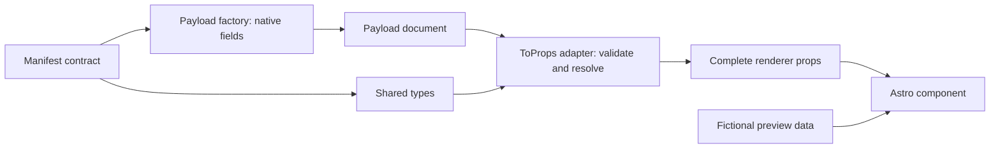

# Building sections in kinekt-sections

Developer handoff for [`kinekt-io/kinekt-sections`](https://github.com/kinekt-io/kinekt-sections), verified against local source on 2026-10-23.

**Scope:** manifests, paired Astro/Payload implementations, types, design tokens, catalogue previews, checks and GitHub workflows. Customer CMS configuration, customer frontend registration and deployment infrastructure are outside this guide.

The token migration is included in this source revision. Package publication remains separate from merging source and deploying the catalogue; older published versions do not necessarily provide this contract. Obtain authorization for future merges and releases.

## 1. Start here

Use Node.js 22.12 or newer and pnpm 10.18.0. The package currently develops against Astro 7.1.3 and Payload 3.88.0. Keep the lockfile; do not upgrade dependencies as part of section work.

From the repository root:

```sh
pnpm install --frozen-lockfile
pnpm dev:catalog --port 4321
```

Open `http://127.0.0.1:4321/kinekt-sections/`. This is the neutral wireframe catalogue with component inspection controls, not a customer website.

On the current workstation, the active checkout is `kinekt-sections-published`, not the older sibling `kinekt-sections`. On another workstation the clone folder can differ; verify the Git remote before editing.

Astro 7 can start a background dev daemon and exit successfully. A terminal exit alone does not mean the preview stopped. Stop this catalogue with:

```sh
pnpm exec astro dev stop --root examples/catalog
```

## 2. Required component files

Choose the role and variation using [`naming-conventions.md`](naming-conventions.md). Search existing manifests before inventing a new section. Variation names identify reusable implementations, not clients or campaigns.

```text
src/sections/<role>/<variation>/
  manifest.json
  <role>-<variation>.astro
  <role>-<variation>.payload.ts
  <role>-<variation>.types.ts
  <role>-<variation>.preview.astro
  README.md
```

| File | Responsibility |
| --- | --- |
| `manifest.json` | Approved content contract, reusable parts, localization and renderer-owned options |
| `.types.ts` | Shared render props and Payload document shapes |
| `.payload.ts` | Native Payload block factory and conversion from CMS data into render props |
| `.astro` | Semantic markup, reusable UI composition, interactions and component styles |
| `.preview.astro` | Realistic fictional data exercising the renderer in the catalogue |
| `README.md` | Purpose, field behavior, variations, accessibility, Figma references and usage notes |

Keep the base name consistent. Do not rename an existing published component or stored Payload block slug without a migration plan.

## 3. Approve the manifest first

Record the approved Figma frame name and clickable URL, desktop/mobile behavior, content fields, optional parts and interactions. A task title is not enough to infer the contract.

Classify reusable parts before treating a whole composition as a section. Reuse Intro, CTA Group, Label, Callout and repeated-item contracts rather than creating section-specific copies of the same fields.

New or changed manifest decisions need review with Odin. For AI-assisted work, use the Dutch `ask` interface. The appendix is an existing example, not approval for a new section.

| Property | Rule |
| --- | --- |
| `$schema`, `schemaVersion` | Current declaration URL and format version `1` |
| `id`, `category`, `role`, `variation` | Match the directory identity |
| `slug` | Component identity; also verify the actual generated or handwritten Payload block slug |
| `version` | Component metadata version, separate from schema format and package version |
| `status` | Maturity; use `prerelease`, not `pre-release` |
| `figma` | Approved HTTPS Figma URL plus supporting node ID |
| `fields` | Editor-owned values, kinds, requiredness and localization |
| `runtimeProps` | Renderer-owned values such as heading level, not CMS content |

Every editor-owned field is localized, including theme, direction choices, desktop/mobile media, CTA data and repeatable content. Nested Payload fields can inherit localization from a localized group or array; do not add conflicting duplicate localization.

`component` references one reusable group through `componentId`. `componentList` references repeatable items and can declare `minItems`. The materializer expands referenced child manifests and rejects missing or circular references.

### Maturity and stored block identifiers

See the README's [component maturity and release stages](README.md#component-maturity-and-release-stages) for review gates, actual generated labels and the distinction between status and package publication.

The generator accepts `planned`, `alpha`, `beta`, `prerelease`, `release`, `released` and `deprecated`. Its stable-name branch currently checks only `status === 'released'`; other statuses normally produce a `beta-` block slug.

Handwritten adapters can retain established slugs. Read More has `status: beta` but stores `read-more-allentown`; Solution List stores `beta-solution-list-allentown` while its manifest slug has no prefix.

Inspect the actual factory output. Do not infer the stored slug from the display label or change it just to remove a maturity prefix.

### Validation limits

There is no local `component-manifest.schema.json` or full JSON Schema validation command in this checkout. The `$schema` URL is a declaration, not evidence that JSON Schema validation ran.

`pnpm exports:generate` performs implemented metadata checks and nested-reference expansion. It does not prove that a handwritten Payload adapter implements every manifest field. Field parity requires review plus a conversion/render smoke check.

## 4. Keep Astro and Payload paired



The package exposes three paired entrypoints. Existing Read More imports illustrate the naming:

```ts
import ReadMore from '@kinekt-io/components/sections/read-more-allentown.astro'
import {
  createReadMoreBlock,
  readMoreToProps,
} from '@kinekt-io/components/sections/read-more-allentown.payload'
import type {
  ReadMoreContent,
  PayloadReadMoreDocument,
} from '@kinekt-io/components/sections/read-more-allentown.types'
```

### Types and conversion

Keep editor documents and render props distinct. A draft can have missing values or upload IDs; Astro should receive validated content and populated media, not raw unresolved IDs.

The `.payload.ts` factory creates native Payload fields. Its `*ToProps()` adapter validates data, converts rich text, resolves destinations/media and returns the shape declared in `.types.ts`. The `.astro` renderer consumes that result without duplicating routing or CMS validation.

Use the shared helpers inside this repository:

| Concern | Source |
| --- | --- |
| Intro, CTA, CTA group and content relationship fields | [`src/shared/payload-fields.ts`](src/shared/payload-fields.ts) |
| Media, CTA, theme and required-value conversion | [`src/shared/payload.ts`](src/shared/payload.ts) |
| Rich-text conversion | [`src/shared/rich-text.ts`](src/shared/rich-text.ts) |
| Recursive manifest-driven Payload fields | [`src/shared/manifest-block.ts`](src/shared/manifest-block.ts) |
| Recursive structural adapter | [`src/shared/structural-props.ts`](src/shared/structural-props.ts) |

Factories accept configured collection names instead of hard-coding a customer's content types. Pass `targetCollections` through shared link fields and `mediaCollection` through upload fields where applicable.

Adapters accept `mediaBaseUrl` and `contentHref(collection, documentID)` through `PayloadAdapterOptions`. The consumer supplies route resolution; the section must not construct customer URLs or import customer CMS code.

### Required behavior

- Primary and secondary CTAs are independently optional, including an entirely empty CTA group.
- Empty actions render no empty buttons or action wrapper.
- All authored button destinations support Content or URL through the shared contract.
- Media carries a safe URL, appropriate alt text and positive dimensions; preserve supplied source sets and fallback metadata.
- Rich text uses the shared conversion boundary before `set:html`; do not accept arbitrary unvalidated HTML as an editor field.
- Reuse `Button`, `Label`, `Callout` and the shared intro implementation where their contracts fit.

Use native groups, arrays and uploads in Payload. Unsupported field shapes require an intentional implementation, not a generic JSON editor.

### Generated versus handwritten sections

The materializer can generate structural `.astro`, `.payload.ts`, `.types.ts` and preview files. A generic structural renderer is useful infrastructure, but does not prove an approved design is complete.

For exact markup, specialized validation or interactions, use the established handwritten implementation pattern. Keep its manifest, factory, adapter, types and preview synchronized.

`scripts/materialize-structural-sections.mjs` recognizes `@generated structural section` markers and additional special-case generation rules. Some Payload wrappers and native-contract previews are forcibly regenerated. Inspect ownership before editing; removing a comment is not a universal conversion to handwritten source.

Reference implementation areas:

- [`read-more-allentown.astro`](src/sections/read-more/allentown/read-more-allentown.astro): handwritten markup and local styles.
- [`read-more-allentown.payload.ts`](src/sections/read-more/allentown/read-more-allentown.payload.ts): factory and adapter structure.
- [`solution-list-allentown.contract.ts`](src/sections/solution-list/allentown/solution-list-allentown.contract.ts): native repeated items and callout contract.

Read More is not a perfect copy template: its manifest/renderer expose an optional label that its current Payload factory/adapter omit, and its implemented heading runtime prop is absent from its manifest. Do not reproduce these contract gaps in new sections.

## 5. Apply tokens inside component styles

### Canonical values and themes

[`src/styles/wireframe-tokens.css`](src/styles/wireframe-tokens.css) defines neutral defaults in `@layer kinekt.tokens`. [`src/styles/wireframe.css`](src/styles/wireframe.css) maps them to semantic roles. Customer sites provide their own canonical values; shared sections stay brand-neutral.

| Theme | Canvas token |
| --- | --- |
| `light` | `--neutral-ultra-light` |
| `semi-light` | `--neutral-light` |
| `semi-dark` | `--primary-dark` |
| `dark` | `--primary-ultra-dark` |

Do not put Tulip colors, fonts or decorative flight paths into the shared wireframes. Keep customer colors outside this repository's component styles.

### Scales to use

| Purpose | Tokens |
| --- | --- |
| Widths | `--content-width`, `--website-width`, `--width-xs` through `--width-xxl`, `--width-50` |
| Gutters/gaps | `--section-gutter`, `--container-gap`, `--content-gap`, `--grid-gap` |
| Component spacing | `--space-xxxs` through `--space-xxl` |
| Section spacing | `--section-space-xxs` through `--section-space-xxl` |
| Type | `--h1` through `--h6`, `--text-xs` through `--text-xxl`, font/weight/line-height tokens |
| Radius | `--radius-none`, `--radius-xs`, `--radius-s`, `--radius-m`, `--radius-l`, `--radius-xl`, `--radius-xxl` |

Fluid outputs interpolate between mobile and desktop inputs, clamping outside their interval. Customers change the input values, not copied equations. Container, content and grid gaps have independently configurable endpoint pairs.

Choose the nearest scale value behind an overridable component variable. Do not preserve arbitrary old pixels through bespoke multipliers. Structural choices such as column ratios, aspect ratios and content-driven breakpoints remain component-owned.

### Native CSS nesting

This pattern belongs inside the Astro component's `<style>` block:

```css
:global(:where(.read-more-allentown)) {
  --kiw--read-more-allentown-content-gap: var(--space-l);
}

.read-more-allentown {
  & .read-more-allentown__content {
    display: grid;
    gap: var(--kiw--read-more-allentown-content-gap);
  }
}
```

Use native CSS nesting, not SCSS. Keep new section-specific layout rules in the component, not broad suffix selectors in `wireframe.css`.

`:global(:where(...))` keeps variable defaults low-specificity. Plain scoped `:where()` gains an Astro scope attribute and can unexpectedly beat customer overrides. Keep actual layout rules in the separate scoped class block.

### Root hooks and the token bridge

A handwritten section imports `../../../styles/wireframe.css` and `sectionTokenBridgeStyle` from `../../../shared/section-token-bridge.js`. Its root carries `data-kinekt-section`, `data-kinekt-theme` and the bridge style using its canonical slug.

For Read More, the root includes `style={sectionTokenBridgeStyle('read-more-allentown')}`. Follow that existing implementation rather than defining a second root token system.

The bridge exposes generic overrides such as `--kiw--<slug>-inline-space` and `--kiw--<slug>-heading-2-size`. Local styles define additional aliases. Existing explicit `--kinekt-section-*` hooks take precedence where present.

Avoid custom-property cycles. A bridged inline-space alias should terminate in `var(--section-gutter)`, not point back to `var(--kinekt-component-inline-space)` on the same root.

### Buttons and headings

```css
:root {
  --buttons-has-radius: 1;
  --buttons-radius: var(--radius-m);
}

.button {
  --kiw--button-allentown-radius: var(--radius-l);
}
```

`0` disables button rounding and `1` enables the selected radius. Use the shared Button instead of duplicating this calculation per section.

Heading level is renderer-owned. Let the shared heading reset derive size from the heading element; do not force one size for all heading levels. Verify heading inspection options on the rendered preview.

## 6. Build useful previews

Add `<slug>.preview.astro` with valid representative props, then run `pnpm exports:generate`. The generator records `previewSource` in `examples/catalog/src/generated/components.json`; routes discover the preview automatically.

| Surface | Path |
| --- | --- |
| Catalogue | `/kinekt-sections/` |
| Inspection | `/kinekt-sections/components/sections/<role>/<variation>/` |
| Iframe | `/kinekt-sections/components/embed/sections/<role>/<variation>/` |

Preserve the base prefix locally and on GitHub Pages. Use the existing base URL logic for links and iframes. Do not manually edit generated catalogue metadata or `package.json` exports.

Custom inspection controls live in `examples/catalog/src/pages/components/[...id].astro`. A manifest runtime prop documents ownership but does not automatically create an inspector control.

Use credible fictional content. No client copy, lorem ipsum or conspicuous placeholder sentences. Accent headings normally stay within three words; fictional contact details use `example.com` and US 555 numbers.

Use semantic HTML, visible keyboard focus and meaningful media alternatives. Prefer `ul` unless order matters, native `details`/`summary` for suitable disclosures, and `article` only for independently meaningful content.

Exercise empty, single-item and multiple-item states where relevant. For example, one Case Studies slide renders statically without carousel pagination. Timed interactions need their approved pause and reduced-motion behavior; do not add interactions to unrelated sections.

## 7. Check before opening a PR

Run the repository's complete check sequence:

```sh
pnpm test
pnpm build
pnpm check
pnpm build:example
pnpm build:catalog
```

This matches the current GitHub Check workflow. `test` also builds the package. `build` regenerates exports, clears shared `dist/` and compiles TypeScript. `build:catalog` creates `examples/catalog/dist/`; dev mode does not require deleting that directory.

### Acceptance checklist

- [ ] Manifest, Payload fields, adapter output and Astro props describe the same contract.
- [ ] Editor-owned fields are localized; runtime props remain renderer-owned.
- [ ] Standard groups, repeatable lists, media and Content/URL links use reusable helpers.
- [ ] Both CTA buttons are independently optional; the fully empty group also works.
- [ ] Adapter smoke covers valid data, absent optional fields and invalid required references.
- [ ] The preview renders real props rather than bypassing conversion failures with casts.
- [ ] All four themes, mobile/desktop widths and long content render correctly.
- [ ] Media reserves dimensions and keeps its intended aspect ratio.
- [ ] Customer token overrides change the appearance without editing component CSS.
- [ ] Inspector controls and relevant keyboard/interaction states work in the browser.
- [ ] Generated exports and catalogue metadata reflect the new files.
- [ ] Checks pass and the PR contains no credentials, customer data or temporary fixtures.

For a packed-consumer check, install a locally packed tarball plus compatible Astro/Payload into a fresh disposable consumer. From this repository, run `node scripts/verify-package.mjs <consumer-directory>`.

The verifier checks installed exports, imports Payload/type entrypoints and compiles Astro plus CSS exports. Its consumer must not already contain `src/pages/index.astro`, which it creates. This complements, but does not replace, visual and adapter behavior checks.

Token arithmetic has been smoke-tested in Chromium. Verify other required browser engines before release rather than claiming cross-browser coverage from that result.

## 8. GitHub workflow and release

| Workflow | Trigger | Behavior |
| --- | --- | --- |
| [`Check`](.github/workflows/check.yml) | Push and pull request | Frozen install, tests, package build, Astro checks, example and catalogue builds |
| [`Deploy component catalogue`](.github/workflows/pages.yml) | Push to `main` or manual dispatch | Builds the catalogue and deploys `examples/catalog/dist` to GitHub Pages |
| [`Publish private package`](.github/workflows/publish.yml) | Manual dispatch, private repository only | Checks, publishes to GitHub Packages, verifies private visibility and fresh registry installation |

A catalogue deployment and a package release are separate operations. A working GitHub Pages preview does not prove that consumers have received a new package version.

For the developer's normal contribution:

1. Work on a feature branch and include the manifest, paired implementation, preview and component documentation.
2. Regenerate exports and include their resulting tracked changes; include lockfile changes only when dependencies change.
3. Run checks and exercise the actual preview, including mobile and theme variants.
4. Open a PR explaining the content contract, reusable parts, generator ownership and observed verification.
5. Obtain review before merging; a push to `main` triggers the catalogue deployment.

Only after release authorization, choose a new immutable package version before committing release changes and invoke the existing publication workflow. Do not reuse a published version, run an ad hoc deployment or assume a PR author may merge/release.

Consumer projects subsequently pin the approved package revision and register its blocks separately. That customer integration is outside this handoff.

## 9. Troubleshooting and known limits

| Symptom | Check |
| --- | --- |
| Preview missing or 404 | Regenerate exports, verify `previewSource`, include `/kinekt-sections/` |
| Your edit disappears after build | The materializer still owns the file or uses a forced special-case generator |
| New `.payload` behavior is stale | Rebuild shared TypeScript; package `.payload` exports resolve through `dist/` |
| Customer CSS override loses | Keep variable defaults low-specificity and check for alias cycles |
| Heading control changes nothing | Check runtime prop handling, actual heading element and local font-size overrides |
| Layout shifts or overflows | Check intrinsic media dimensions, wrapping/min-width and competing generic CSS |
| Manifest appears valid but fields differ | Manual validators do not prove parity with handwritten code |
| Pages looks updated but package is old | Catalogue deploy and package publish use separate workflows |

The current generator does not perform full JSON Schema validation or automatically verify all handwritten contracts. Review field parity explicitly. Existing implementation exceptions are not permission to introduce another exception.

## Appendix: existing manifest contract

Reference: [Solution List Allentown, desktop section](https://www.figma.com/design/7rHrxb3twyBvPo9QxkOBly/KSW-1-Tulip-Tech-Website?node-id=5240-411423), and its [manifest source](src/sections/solution-list/allentown/manifest.json).

This is an existing contract, not a new proposal. For a new section, use its approved identity, version, Figma reference and fields rather than copying this identity.

```json
{
  "$schema": "https://kinekt.io/schemas/component-manifest.schema.json",
  "schemaVersion": 1,
  "version": "26.10.0-beta.0",
  "id": "sections/solution-list/allentown",
  "slug": "solution-list-allentown",
  "title": "Solution List Allentown",
  "description": "A reusable section that composes a standard Intro Block, a list of two or more Solution Items, and an optional Callout with CTA Group.",
  "category": "sections",
  "tags": ["solutions", "product", "prerelease"],
  "role": "solution-list",
  "variation": "allentown",
  "status": "prerelease",
  "figma": {
    "url": "https://www.figma.com/design/7rHrxb3twyBvPo9QxkOBly/KSW-1-Tulip-Tech-Website?node-id=5240-411423&t=mG3L6xlBzomA03GY-11",
    "nodeId": "5240:411423"
  },
  "fields": {
    "theme": { "kind": "select", "required": true, "localized": true, "options": ["light", "semi-light", "semi-dark", "dark"] },
    "intro": { "kind": "component", "componentId": "components/intro/allentown", "required": true, "localized": true },
    "items": { "kind": "componentList", "componentId": "components/solution-item/allentown", "required": true, "localized": true, "minItems": 2 },
    "callout": { "kind": "component", "componentId": "components/callout/allentown", "required": false, "localized": true }
  },
  "runtimeProps": {
    "headingLevel": { "kind": "headingLevel", "source": "renderer" }
  }
}
```
